## Structure of the presentation 

 

* SAR images;

* Rayleigh distribution;

* Shannon entropy;

* Hypothesis testing;

* Results obtained;

* Conclusion;

---

## About paper

<!-- Antes de tudo vamos entender o que é um radar e sua importância nesta tese.
-->

Publication on **IEEE Transactions on Geoscience and Remote Sensing**:

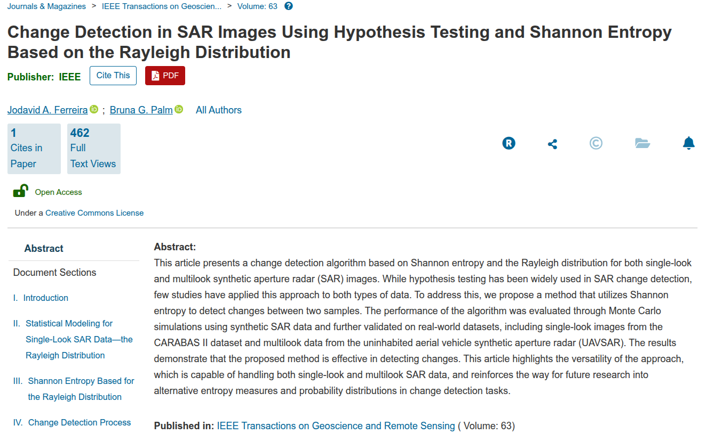{fig-align="center" width="550"}

<!-- Machine learning classification based on $k$-Nearest Neighbors for PolSAR data   -->
<!--   -->
<b>Authors:</b> Ferreira, J.A. \& Palm, B.G.
 
<b>Year:</b> 2025 - <b>DOI (link):</b> <a href="https://doi.org/10.1109/TGRS.2025.3601857" target="_blank">10.1109/TGRS.2025.3601857</a>

<!--
---

 ## Notation

:::: {.columns}

::: {.column width="18%"}

-   $X$ or $Y$
-   $x$ or $y$
-   $\mathbf{x}$ or $\mathbf{y}$
-   $\dot{\mathbf{x}}$ or $\dot{\mathbf{y}}$
-   $\mathbf{X}$ or $\mathbf{Y}$
-   $\dot{\mathbf{X}}$ or $\dot{\mathbf{Y}}$

<pre></pre>

-   $p$
-   $n$
-   $i$
-   $j$

:::

::: {.column width="80%"}

represent random variables (r.v.);

represent realizations of random variables;

represent random vectors;

represent realizations of random vectors;

represent random matrices;

represent realizations of random matrices;

<pre></pre>

dimension of features, variables, parameters

sample size

$i$-th observation, instance (e.g., $i=1, ..., n$)

$j$-th feature, variable, parameter (e.g., $j=1, ..., p$)

:::
::::

--- -->

## Introduction

<!-- Antes de tudo vamos entender o que é um radar e sua importância nesta tese.
-->

* **RADAR** is an acronym of *Radio Detection and Ranging*

. . .

* It is based on the principles of electromagnetic propagation, in which
an electromagnetic wave is emitted by a source and is backscattered to radar

. . .

* According to Zyl (2011), a radar image is the result of an interaction
between the energy launched by the radar and the object under study and the
appearance of the image is influenced by the shape and texture of the target

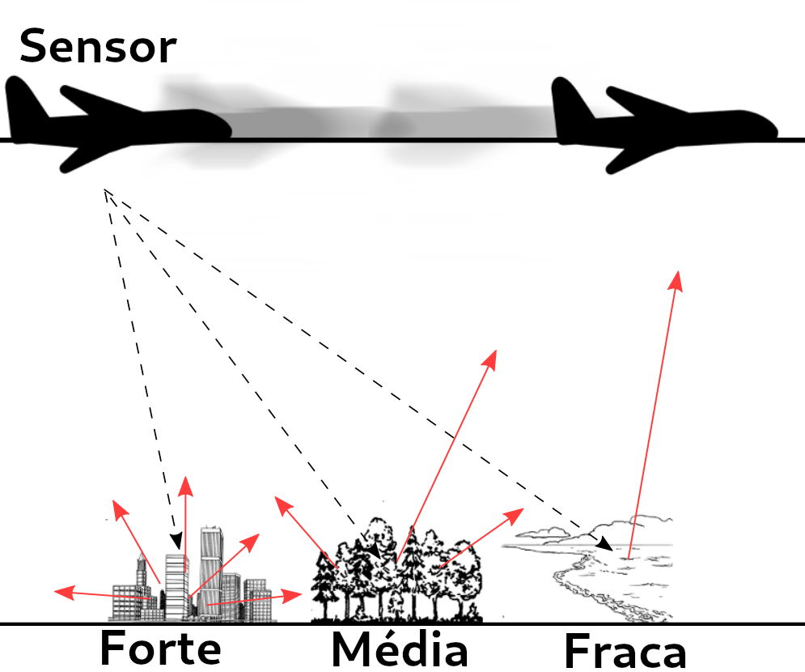{.fixed fig-align="center" width="30%"}

---

## Introduction

* Synthetic Aperture Radar (SAR) is coupled to a platform that transmits
microwaves along its intended route towards a geographic scene;

. . .

* Pulses emitted towards a real scenario may have circular and/or linear
polarizations;

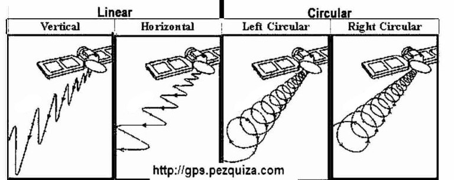{fig-align="center" width="50%"}

. . .

* When only one pair of directions is used, the images generated are
called monopolarized *SAR* and, when multiple directions are used,
the process is called *PolSAR (Polarimetric SAR)*;

---

## Introduction

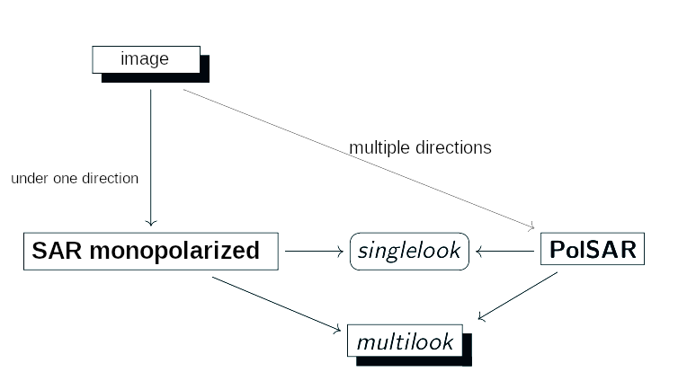{fig-align="center"}

---

## Introduction

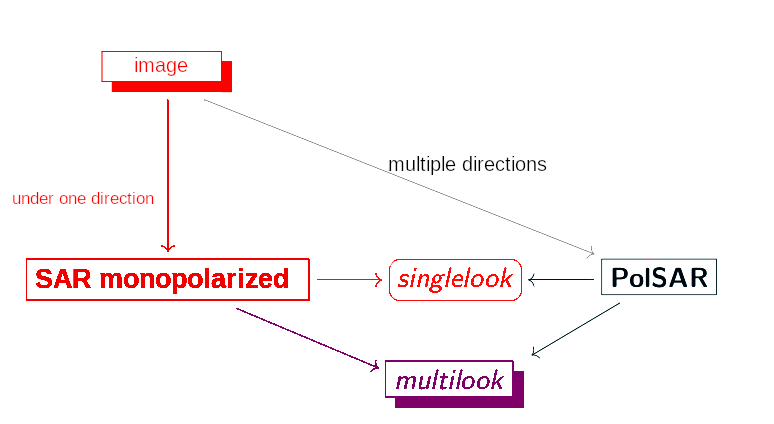{fig-align="center"}

---

## Introduction

 

<h4>Advantages</h4>

* *SAR* images can be obtained in from anywhere (land, sea, air);
* at any time (day or night);
* in almost all weather conditions (clouds, rain);
* produce high-resolution (high-bandwidth) images of the surfaces studied;

. . .

 

<h4>Disadvantages</h4>

* high cost;
* the images obtained are affected by a noise called *speckle*, which creates
a granular appearance in the images, making interpretation and analysis difficult;

. . .

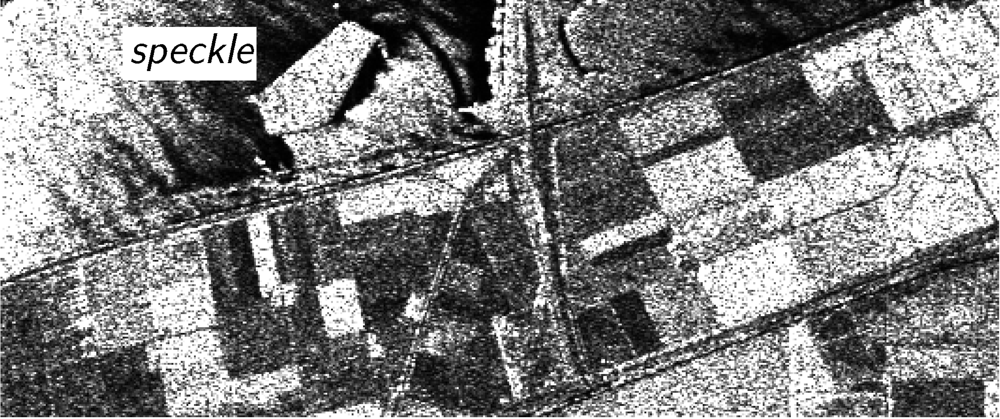

---

## Introduction

 

{fig-align="center"}

---

## Introduction 

 

> *Speckle* imposes on *SAR/PolSAR* data a multiplicative nature such that
*SAR* intensities or multidimensional intensities of a given *PolSAR* do not
behave like the normal or Gaussian law.

. . .

 

Methods considering speckle action have been proposed in several areas:

. . .

<!-- 1. Classification^[(FRERY; CORREIA; FREITAS , 2007),
2. segmentação (BEAULIEU; TOUZI , 2004), 
3. detecção de borda (SCHOU et al. , 2003),
4. detecção de mudança (NASCIMENTO; FRERY; CINTRA , 2018). -->

1. Classification;
2. Segmentation;
3. Edge detection;
4. Change detection;

---

## Polarimetric Data 

 

- PolSAR image is such that each entry is associated with the elements of the following matrix:
	
$$
\mathbf{S}=\left( \begin{array}{cc}
S_{hh} & S_{hv} \\
S_{vh} & S_{vv} \end{array} \right)
\label{matrizpolar}
$$

where $S_{hh}$, $S_{hv}$, $S_{vh}$ and $S_{vv}$ are the complex scattering coefficients of the target for the respective polarization channels, and the subscripts $h$ and $v$ represent the horizontal and vertical polarization, respectively, and, 

$$
S_{rs} = A_{rs} e^{i \phi_{rs}},
$$

where $A_{rs}$ is the amplitude of the scattering coefficient and $\phi_{rs}$ is the phase of the scattering coefficient, for $r,s \in \{h,v\}$.

---

## Polarimetric Data 

 

- In practice, the cross-polarizations are very similar; that is, $S_{hv} \approx S_{vh}$.
Thus, the above matrix

$$
\mathbf{S}=\left( \begin{array}{cc}
S_{hh} & S_{hv} \\
S_{vh} & S_{vv} \end{array} \right)
$$

can be represented as

$$
\mathbf{z}=\left( \begin{array}{c}
S_{hh}\\
S_{hv}\\
S_{vv} \end{array} \right)
\label{matrizpolarreduzida}
$$

<!-- 

---

## Polarimetric Data *single-look*

 

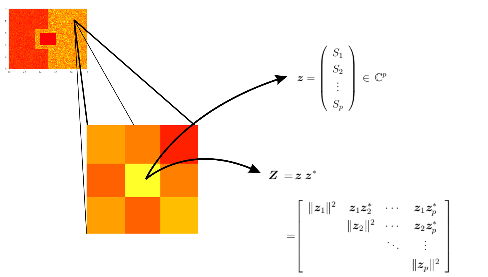{fig-align="center" width="40%"}

$\mathbf{z} = [S_1\,S_2\,\cdots\,S_p]^{\top} \, \in \mathbb{C}^{p}$
is the vector associated with $p$ polarization channels.

---
-->

## Polarimetric Data *multi-look*

 

- PolSAR data *single-look* don't take into account the control of the
		*speckle* effect on images

. . .

- A process to circumvent this is called *multi-look processing*
	
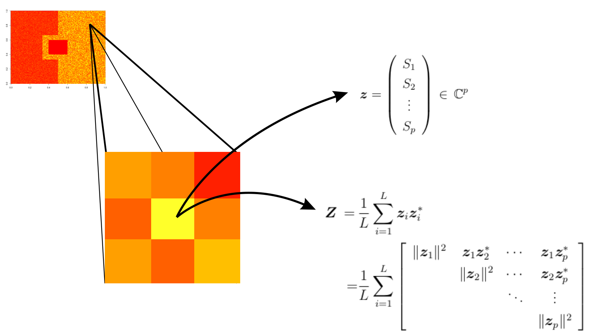{fig-align="center" width="40%"}

---

## Polarimetric Data *multi-look*

 

$\mathbf{z}_i = (S_1^{(i)}\,S_2^{(i)}\,\cdots\,S_p^{(i)})^{\top} \, \in \mathbb{C}^{p}$
is the $i$-th vector associated with $p$ polarization channels in a sample of $L$
extracted information from the same scene, for $i=1,\ldots,L$.

{fig-align="center" width="40%"}

---

## Polarimetric Data

 

- A *PolSAR* image can be understood as a scene, in which each entry is associated with a positive definite Hermitian matrix, which requires the use of multivariate processing methods.

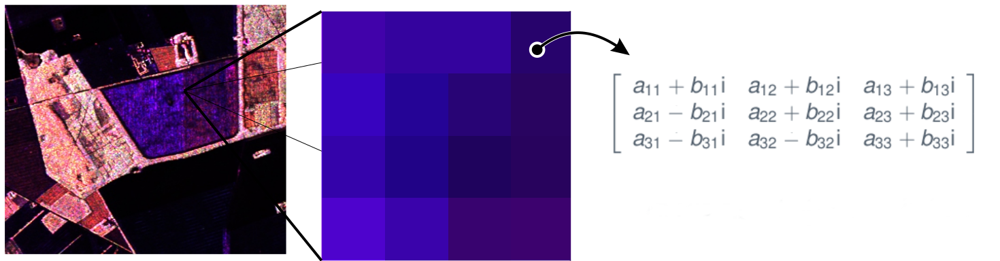{fig-align="center" width="40%"}

---

## Statistical Modeling
<h4> The Rayleigh Distribution</h4>

 

<h4>Why Use the Rayleigh Distribution?</h4>

 

*   Central Limit Theorem (CLT) applied to complex signal components (In-phase and Quadrature).

<pre></pre>

*   If components are independent Gaussians, the resulting **amplitude** follows a Rayleigh distribution.

<pre></pre>

*   Standard model for homogeneous areas in amplitude SAR images.

---

## Statistical Modeling
<h4> The Rayleigh Distribution</h4>

 

Let $Y$ be a Rayleigh-distributed random variable with scale parameter $\beta > 0$:

$$f_Y(y; \beta) = \frac{y}{\beta^2} e^{-\frac{y^2}{2\beta^2}}, \quad y \geq 0,$$

<!-- <pre></pre>

*   Support: $[0, \infty)$. -->

where

$$E(Y) = \beta \sqrt{\frac{\pi}{2}}, $$

and

$$Var(Y) = \beta^2 \left( \frac{4 - \pi}{2} \right).$$

---

## Statistical Modeling
<h4>Log-Likelihood Function and (MLE)</h4>

Given a sample $y_1, \dots, y_N$, the log-likelihood function is defined as

$$\ell(\beta) = \sum_{n=1}^{N} \left[ \log(y_n) - 2\log(\beta) - \frac{y_n^2}{2\beta^2} \right].$$

Differentiating with respect to $\beta$ (Score Function)
$$U_\beta = \frac{d\ell(\beta)}{d\beta} = \sum_{n=1}^{N} \left[ -\frac{2}{\beta} + \frac{y_n^2}{\beta^3} \right],$$

and result in the estimator

$$\hat{\beta} = \sqrt{\frac{1}{2N} \sum_{n=1}^{N} y_n^2}$$

---

## Statistical Modeling
<h4>Fisher Information</h4>

The second-order derivative of the log-likelihood:
$$\frac{d^2\ell(\beta)}{d\beta^2} = \sum_{n=1}^{N} \left[ \frac{2}{\beta^2} - \frac{3y_n^2}{\beta^4} \right]$$

Taking the negative expectation:
$$\mathcal{K}(\beta) = -E\left[ \frac{2}{\beta^2} - \frac{3Y^2}{\beta^4} \right]$$

Since $E(Y^2) = 2\beta^2$:
$$\mathcal{K}(\beta) = N \left( -\frac{2}{\beta^2} + \frac{6\beta^2}{\beta^4} \right) = \frac{4N}{\beta^2}$$

---

## Statistical Modeling
<h4>Asymptotic Normality</h4>

 

For $N$ sufficiently large, the MLE converges in distribution:

$$\hat{\beta} \xrightarrow{\mathcal{D}} \mathcal{N}\left(\beta, \mathcal{K}(\beta)^{-1}\right)$$

 

where "$\xrightarrow[]{\mathcal{D}}$" denotes *convergence in distribution*
and the asymptotic variance is

 

$$\sigma^2_{\hat{\beta}} = \frac{\beta^2}{4N}$$

---

## Information Theory in SAR/PolSAR

 

Two important concepts are "Information" and "Entropy," which were initially defined in the context of communication theory by Shannon (1948). He determined that a suitable function to quantify information while preserving additivity is the logarithmic function; that is,

 

$$
I(Z) = \log_b\left(\frac{1}{f(Z)}\right) = - \log_b\left(f(Z)\right),
$$

where $Z$ is a random variable, $f(Z)$ is a density (or probability mass function), $b$ is the base of the logarithm used, and commonly used values for $b$ are $2$, Euler’s number ($e$), and $10$.

---

## Information Theory in SAR/PolSAR

 

Through Boltzmann's H-theorem (BOLTZMANN, 1970), Shannon defined the entropy of a continuous random variable $Z$ as:

$$H(Z) = E[I(Z)] = E[-\ln(f(Z))],$$

where $E(\cdot)$ is the expected value operator and $I(Z)$ is the information obtained from $Z$ (BORDA, 2011). Entropy can be rewritten as:
	
$$H(Z) = \int f(z)I(z)dz = - \int f(z)\log_b f(z)dz.$$

---

## Information Theory in SAR/PolSAR
<h4>The h-$\phi$ Entropy Class</h4>

 

In 1994, Salicrú et al. (1994) proposed the ($h, \phi$) entropy class—which generalizes the original concept of entropy—and its asymptotic distributions.

Let $f_{Z}(z;\boldsymbol{\theta})$ be the density function of $Z$ with parameter vector $\boldsymbol{\theta} \in \boldsymbol{\Theta} \subseteq \mathbb{R}^p$. The ($h, \phi$) entropy class of $Z$ is defined by:

$$H_{\phi}^h(\boldsymbol{\theta})\,=\,h\Big(\,\int_{\mathcal A}\phi(\,f_{Z}(z;\boldsymbol{\theta})\,)\mathrm{d}z\,\Big),$$

where $\phi:\bigl[0,\infty\bigr) \rightarrow \mathbb{R}$ is concave and $h:\mathbb{R} \rightarrow \mathbb{R}$ is increasing, or $\phi$ is convex and $h$ is decreasing. In particular, Shannon Entropy is obtained when $h(x)=x$ and $\phi(x)=-x\,\log(x)$. 

---

## Information Theory in SAR/PolSAR
<h4>The h-$\phi$ Entropy Class</h4>

 

The following result was proposed by Pardo et al. (1997) and addresses the use of entropy in statistical inference methods.

  
 
  Lemma 1:
  

  
Let $\widehat{\boldsymbol{\theta}} = [\widehat{\theta_1}, \widehat{\theta_2}, \dots, \widehat{\theta_p}]^\top$ be the maximum likelihood estimator (MLE) for $\boldsymbol{\theta} = [\theta_1, \theta_2, \dots, \theta_p]^\top$ based on a random sample (independent and identically distributed sample) $Z_1, \dots, Z_N$ from $Z$ with density $f(z;\boldsymbol{\theta})$. Then:

$$
\sqrt{N} \big[H_h^\phi(\widehat{\boldsymbol{\theta}})-H_h^\phi(\boldsymbol{\theta})\big] \xrightarrow[N\rightarrow \infty]{\mathcal D} \mathcal N\left(0,\sigma_{\phi}^2(\boldsymbol{\theta})\right).
$$

---

## Information Theory in SAR/PolSAR
<h4>The h-$\phi$ Entropy Class</h4>

 

  
 
  Lemma 1 - cont.:
  

where $\mathcal N(\mu,\sigma^2)$ is the Normal distribution with mean $\mu$ and variance $\sigma^2$, "$\xrightarrow[]{\mathcal{D}}$" denotes convergence in distribution,

$$
\sigma_{\phi}^2(\boldsymbol{\theta})=\boldsymbol{\delta}^\top \boldsymbol{{\mathcal K}}(\boldsymbol{\theta})^{-1}\boldsymbol{\delta},
$$

$\small \boldsymbol{{\mathcal K}}(\boldsymbol{\theta}) = E\{ -\partial^2 \log f_{Z}(Z;\boldsymbol{\theta})/ \partial \boldsymbol{\theta}\,\partial \boldsymbol{\theta}^\top\}$ is the Fisher Information Matrix (FIM) and $\small \boldsymbol{\delta}=[\delta_1,\dots,\delta_p]^\top$ such that $\delta_i = \partial H_h^\phi(\boldsymbol{\theta}) / \partial \theta_i$ for $i=1, 2, \dots, p$.

---

## Information Theory in SAR/PolSAR
<h4>The h-$\phi$ Entropy Class</h4>

 

According to Nascimento, Frery, and Cintra (2018), the methodology for hypothesis testing and confidence intervals based on Shannon entropy is given as follows:

$$
\left\lbrace \begin{array}{cl}
\mathcal{H}_0 : & H_S(\boldsymbol{\theta}_1)=H_S(\boldsymbol{\theta}_2)=\dots=H_S(\boldsymbol{\theta}_q) = \nu, \\
\mathcal{H}_1 : & \exists\, i,j \text{, such that } H_S(\boldsymbol{\theta}_i) \neq H_S(\boldsymbol{\theta}_j).
\end{array} \right.
$$

 

**Is there any statistical evidence to reject the assumption that 'q' SAR/PolSAR samples come from the same model?**

---

## Information Theory in SAR/PolSAR 
<h4>The h-$\phi$ Entropy Class</h4>

 

To answer the question, from Lemma 1, we have:

$$\sum\limits_{i=1}^q\dfrac{N_i(H_\text{S}(\widehat{\boldsymbol{\theta}}_i) - \overline{\nu})^2}{\sigma_{\text{S}}^2(\widehat{\boldsymbol{\theta}}_i)} \xrightarrow[N_i\rightarrow \infty]{\mathcal D} \chi^2_{q-1},$$

where:

$$
\overline{\nu} = 
\left[\sum\limits_{i=1}^q\dfrac{N_i}{\sigma_{\text{S}}^2(\widehat{\boldsymbol{\theta}}_i)}\right]^{-1}
\sum\limits_{i=1}^q\dfrac{N_iH_\text{S}(\widehat{\boldsymbol{\theta}}_i)}{\sigma_{\text{S}}^2(\widehat{\boldsymbol{\theta}}_i)}.
$$

---

## Information Theory in SAR/PolSAR
<h4>The h-$\phi$ Entropy Class</h4>

 
An answer to the question can be given by the following test statistic:

 

$$
S_\text{S}(\widehat{\boldsymbol{\theta}}_1,\dots,\widehat{\boldsymbol{\theta}}_q)\,=\,
\sum\limits_{i=1}^q\dfrac{N_i(H_\text{S}(\widehat{\boldsymbol{\theta}}_i) - \overline{\nu})^2}{\sigma_{\text{S}}^2(\widehat{\boldsymbol{\theta}}_i)}.
$$

---

## Information Theory in SAR/PolSAR
<h4>The h-$\phi$ Entropy Class</h4>

 

From the obtained results, the following proposition can be shown:

  
 
  Proposition 1:
  

  
Let $\widehat{\boldsymbol{\theta}}_i$ for $i=1,\dots,q$ be MLEs based on independent and sufficiently large random samples of size $N_i$. If $S_S(\widehat{\boldsymbol{\theta}}_1,\dots,\widehat{\boldsymbol{\theta}}_q) = s$, then the null hypothesis $\mathcal{H}_0$ can be rejected at a nominal level $\alpha$ if $P(\chi_{q-1}^2 > s) \leq \alpha$.

---

## Information Theory in SAR/PolSAR
<h4>The h-$\phi$ Entropy Class</h4>

 

 
In the case of comparing two samples of the same size $(N_1=N_2=N)$, the test statistic reduces to:

 

$$
S_\text{S}(\widehat{\boldsymbol{\theta}}_1,\widehat{\boldsymbol{\theta}}_2) =N\dfrac{\left[H_\text{S}(\widehat{\boldsymbol{\theta}}_1) - H_\text{S}(\widehat{\boldsymbol{\theta}}_2)\right]^2}{\sigma_{\text{S}}^2(\widehat{\boldsymbol{\theta}}_1) + \sigma_{\text{S}}^2(\widehat{\boldsymbol{\theta}}_2)}.
$$

---

## Shannon Entropy for Rayleigh

 

For $Y \sim \mathcal{R}(\beta)$, the differential entropy is:

 

$$H_\text{S}(\beta) = 1 + \log\left( \frac{\beta}{\sqrt{2}} \right) + \frac{\gamma}{2}.$$

 

*   $\gamma \approx 0.5772$ (Euler-Mascheroni constant).

 

*   The entropy increases logarithmically with the scale parameter $\beta$.

---

## Variance of Stochastic Entropy

 

Using the Delta Method, the variance of the estimated entropy $H_\text{S}(\hat{\beta})$ is:

$$\sigma_{\text{S}}^2(\beta) = \boldsymbol{\delta}^\top \mathcal{K}(\beta)^{-1} \boldsymbol{\delta},$$

 

where $\delta = \frac{\partial H_\text{S}(\beta)}{\partial \beta} = \frac{1}{\beta}$.
Substituting $\mathcal{K}(\beta)^{-1} = \frac{\beta^2}{4}$:

 

$$\sigma_{\text{S}}^2(\beta) = \left(\frac{1}{\beta}\right)^2 \cdot \frac{\beta^2}{4} = \frac{1}{4}$$

*   **Key Result:** The variance of Shannon entropy for the Rayleigh distribution is constant (independent of $\beta$).

---

## Test Formulation for Rayleigh

 

Comparing two independent samples (Before vs. After):
$$
\begin{cases}
\mathcal{H}_0 : H_\text{S}(\beta_1) = H_\text{S}(\beta_2) \quad \text{(No Change)} \\
\mathcal{H}_1 : H_\text{S}(\beta_1) \neq H_\text{S}(\beta_2) \quad \text{(Change)}
\end{cases}
$$

<!-- This approach tests whether the "disorder" or uncertainty of the scene has significantly shifted.

---

## The $S_S$ Test Statistic

For samples of size $N_1$ and $N_2$:
$$S_\text{S}(\hat{\beta}_1,\hat{\beta}_2) = \frac{(H_\text{S}(\hat{\beta}_1) - H_\text{S}(\hat{\beta}_2))^2}{\frac{\sigma_\text{S}^2(\hat{\beta}_1)}{N_1} + \frac{\sigma_\text{S}^2(\hat{\beta}_2)}{N_2}}$$

Given $\sigma_\text{S}^2 = 1/4$:
$$S_\text{S} = \frac{4 N_1 N_2}{N_1 + N_2} (H_\text{S}(\hat{\beta}_1) - H_\text{S}(\hat{\beta}_2))^2$$

---

## Null Distribution

 -->

Under $\mathcal{H}_0$:
$$S_\text{S} \xrightarrow{\mathcal{D}} \chi^2_{1}$$

*   **Decision Rule:** Reject $\mathcal{H}_0$ if $P(\chi^2_1 > S_\text{S}) < \alpha$.
*   Typical nominal levels ($\alpha$) for SAR: $10^{-3}$ or $10^{-4}$ to handle the large number of pixels (multiple testing).

---

## Detection Algorithm
<h4>Sliding Window Approach</h4>

:::: {columns}
::: {.column width="50%"}

1.  Define a window size $w \times w$ (e.g., $3\times3$).

2.  Traverse images $Image_1$ and $Image_2$ pixel by pixel.

3.  Estimate local $\hat{\beta}_1$ and $\hat{\beta}_2$ using the window samples.

4.  Compute the $S_S$ statistic for each location.

5.  Generate a binary change map based on the threshold.

:::
::: {.column width="50%"}

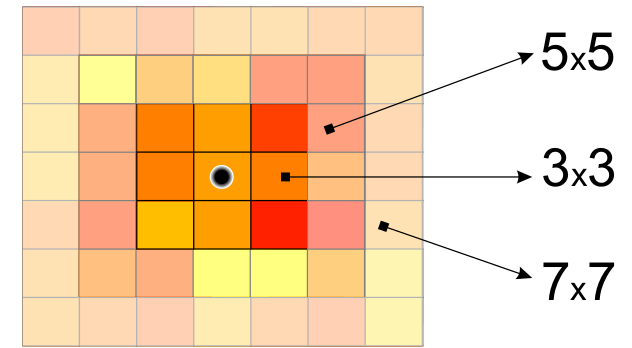{width="70%" fig-align="center"}

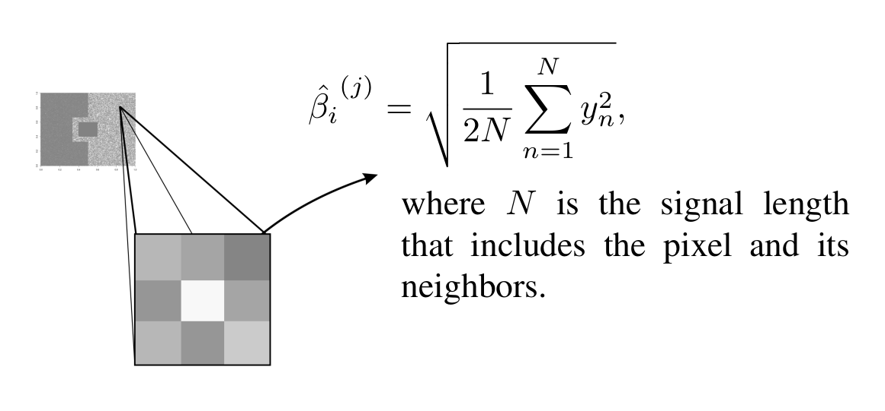{width="100%" fig-align="center"}

:::
::::

---

## Monte Carlo Simulations
<h4>Type I Error Evaluation</h4>

*   5,000 replications.
*   $\beta_1 = \beta_2 = 0.173$.

| Window | $N$ | 10% Level | 5% Level | 1% Level | $\overline{S_S}$ |
| :---: | :---: | :---: | :---: | :---: | :---: |
| $3\times3$ | 9 | 0.1034 | 0.0501 | 0.0111 | 1.029 |
| $5\times5$ | 25 | 0.1036 | 0.0514 | 0.0124 | 1.0341 |
| $7\times7$ | 49 | 0.1064 | 0.0531 | 0.0131 | 1.0317 |
| $9\times9$ | 81 | 0.0948 | 0.0472 | 0.0096 | 0.9885 |
| $11\times11$ | 121 | 0.0971 | 0.0534 | 0.0118 | 0.9885

---

## ROC Curve Analysis

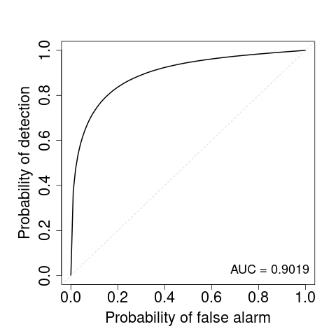{fig-align="center" width="60%"}

Receiver Operating Characteristic (ROC) curve obtained through Monte Carlo simulations using samples from two Rayleigh distributions with scale parameters $\hat{\sigma}_0 = 0.173$ and $\hat{\sigma}_1 = 0.173+0.03$ and $n = 200$. The area under the curve (AUC = 0.9019) indicates strong discriminative performance of the proposed change detector.

<!-- *   **AUC = 0.9019.** Excellent separability for subtle parameter variations ($\Delta \beta = 0.03$). -->

---

## Test Power ($\alpha = 1\%$)

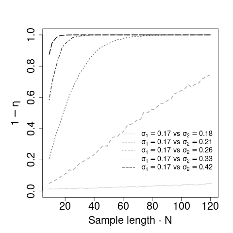{fig-align="center" width="60%"}

*   Convergence to 1 as the sample size $N$ increases.

---

## Test Power ($\alpha = 5\%$)

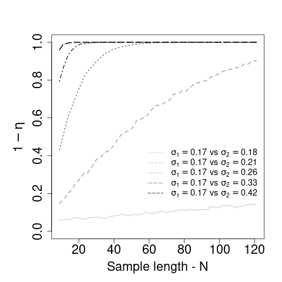{fig-align="center" width="60%"}

---

## Test Power ($\alpha = 10\%$)

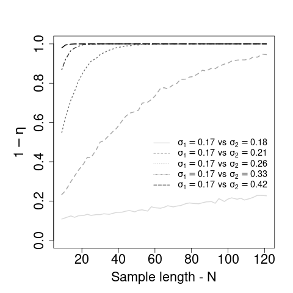{fig-align="center" width="60%"}

---

## Results: CARABAS II
<h4>Dataset Description</h4>

*   Image Single-look CARABAS II (Sweden).
*   UWB VHF System (Sweden).
*   Targets: 25 military vehicles concealed within forests.
*   Challenge: Distinguishing vehicles from tree trunks and natural clutter.

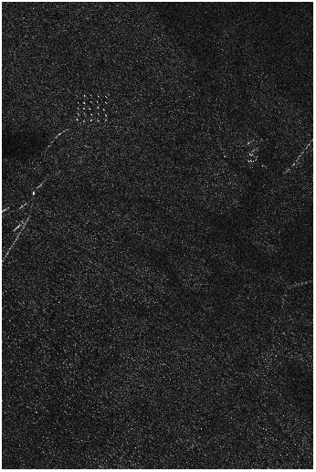{width="45%" fig-align="center"}

---

## Results: CARABAS II
<h4>Dataset Description</h4>

:::: {columns}
::: {.column width="25%"}

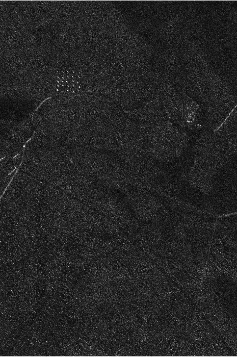{width="65%" fig-align="center"}

:::
::: {.column width="25%"}

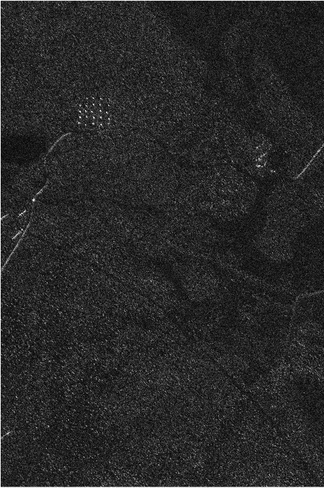{width="65%" fig-align="center"}

:::
::: {.column width="25%"}

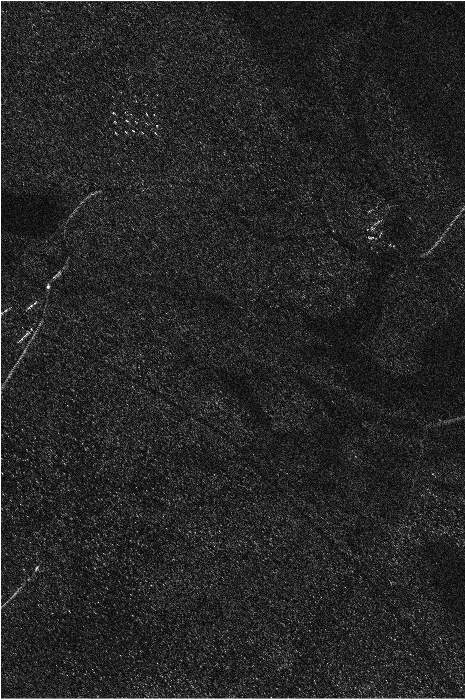{width="65%" fig-align="center"}

:::
::: {.column width="25%"}

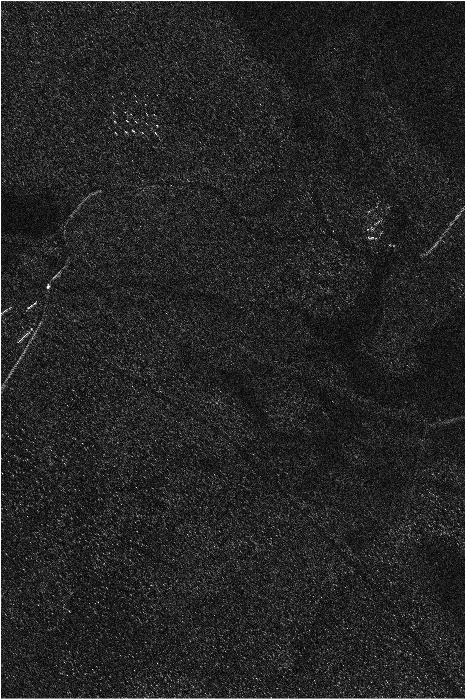{width="65%" fig-align="center"}

:::
::::

:::: {columns}
::: {.column width="25%"}

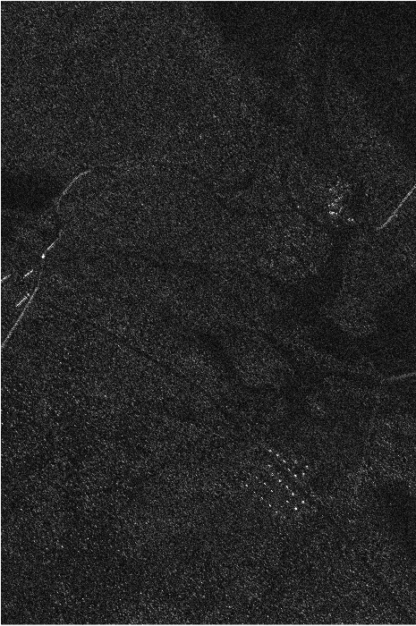{width="65%" fig-align="center"}

:::
::: {.column width="25%"}

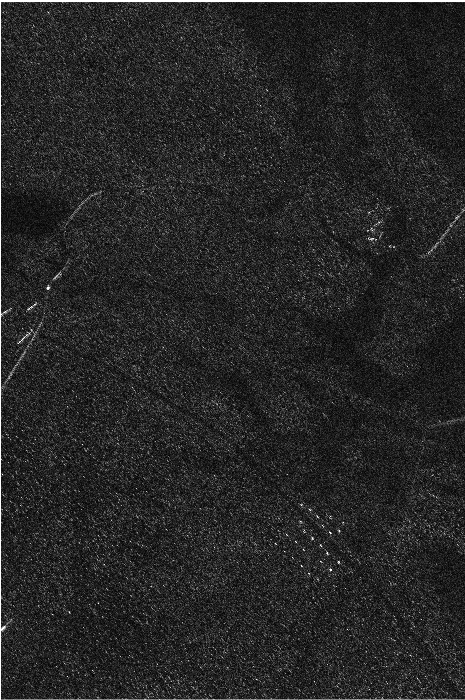{width="65%" fig-align="center"}

:::
::: {.column width="25%"}

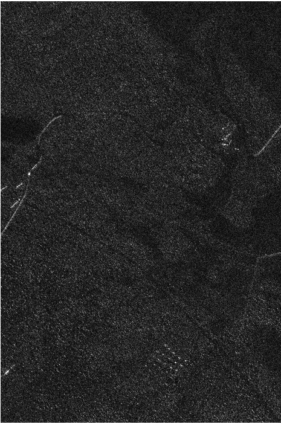{width="65%" fig-align="center"}

:::
::: {.column width="25%"}

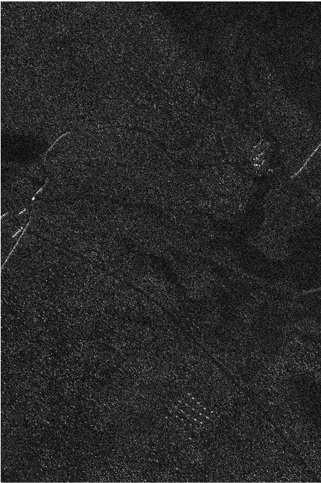{width="65%" fig-align="center"}

:::
::::

---

## Results: CARABAS II
<h4>Dataset Description</h4>

:::: {columns}
::: {.column width="50%"}

{width="60%" fig-align="center"}

Scene with Targets

:::
::: {.column width="50%"}

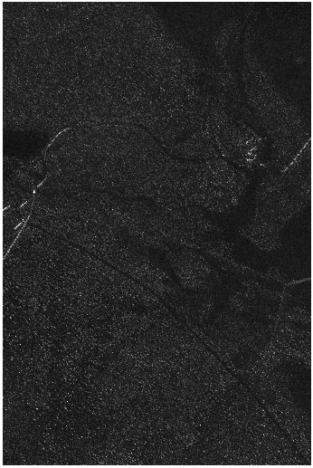{width="60%" fig-align="center"}

Ground Truth (Median-based)

:::
::::

---

## Results: CARABAS II
<h4>Change Map</h4>

:::: {columns}
::: {.column width="50%"}

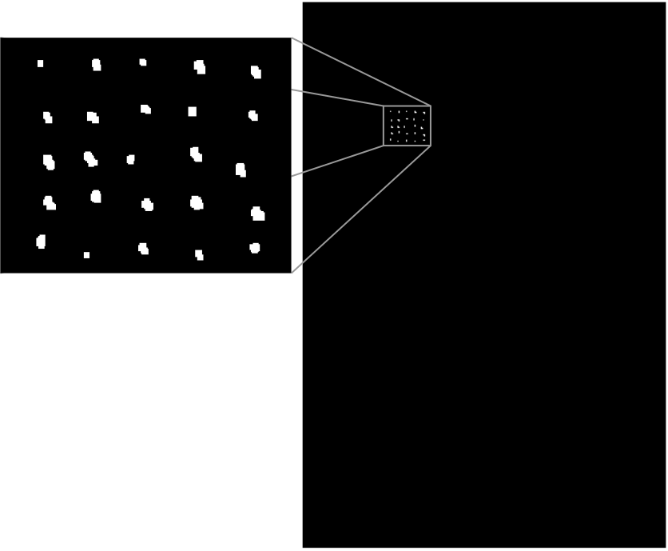{fig-align="center" width="100%"}

:::
::: {.column width="50%"}

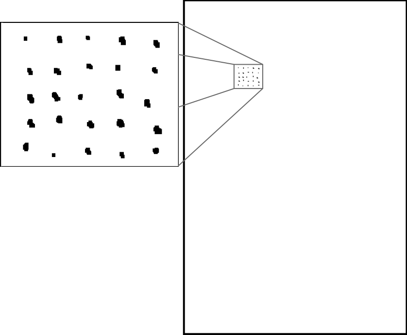{fig-align="center" width="100%"}
:::
::::

*   **Result:** All 25 targets successfully detected.
*   Zero false alarms recorded in this specific scene.

---

## UAVSAR (Los Angeles)
<h4>Dataset Description</h4>

* Image Multi-look UAVSAR (California, USA).
*   L-Band Sensor (NASA/JPL).
*   Multitemporal: April 2009 vs. May 2015.
*   Complex urban scene with significant structural changes.

<!-- ---

## Temporal Images

 -->

:::: {columns}
::: {.column width="33%"}

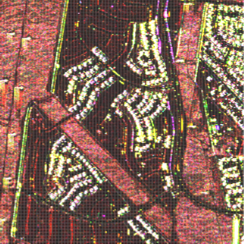{width="70%" fig-align="center"}

April 2009

:::
::: {.column width="33%"}

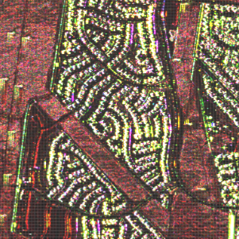{width="70%" fig-align="center"}

May 2015

:::
::: {.column width="33%"}

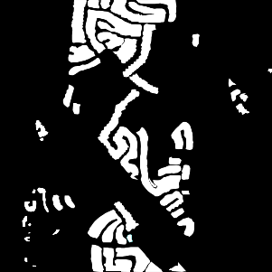{width="70%" fig-align="center"}

Ground Truth

:::
::::

---

## UAVSAR (Los Angeles)
<h4>Detection Result: HH, HV and VV Channels</h4>

 

:::: {columns}
::: {.column width="33%"}

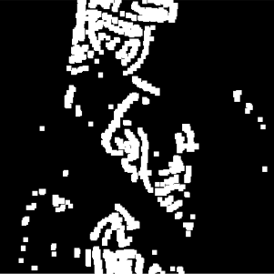{fig-align="center" width="100%"}

HH Channel

:::
::: {.column width="33%"}

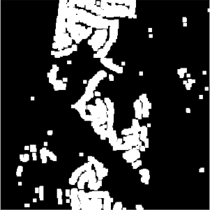{fig-align="center" width="100%"}

HV Channel

:::
::: {.column width="33%"}

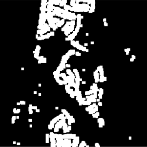{fig-align="center" width="100%"}

VV Channel

:::
::::

---

## UAVSAR (Los Angeles)
<h4>Performance Evaluation of Change Detection Method</h4>

 

<!-- | Method | DR (%) | $\kappa$ (%) | MCC |
| :--- | :---: | :---: | :---: |
| $S_{KL}$ (Nascimento, 2018) | 19.77 | 23.02 | - |
| DRT (Bouhlel, 2020) | 63.38 | - | - |
| **$S_S(\mathcal{R})$ - HH** | **79.86** | 72.22 | 0.72 |
| **$S_S(\mathcal{R})$ - VV** | 74.13 | **75.69** | **0.76** |

---

### Performance Evaluation of Change Detection Methods (Los Angeles UAVSAR)

-->

| Detectors | Channel | FP (%) | FN (%) | FA (%) | DR (%) | $\kappa$ (%) | MCC |
| :--- | :--- | :---: | :---: | :---: | :---: | :---: | :---: |
| $S_{LR}$ [1] | all channels | 0.06 | 13.43 | 13.49 | 20.41 | 24.56 | - |
| $S_{KL}$ [1] | all channels | 0.05 | 14.06 | 14.11 | 19.77 | 23.02 | - |
| $S_{S}$ [1] | all channels | 0.34 | 5.47 | 5.82 | 35.39 | 52.48 | - |
| $S_{R}$ [1] | all channels | 0.43 | 3.71 | 4.14 | 42.99 | 62.27 | - |
| DRT [2] | all channels | - | - | - | 63.38 | - | - |
| HLT [2] | all channels | - | - | - | 52.83 | - | - |
| **$S_{S}(\mathcal{R})$** | HH | 4.13 | 2.82 | 8.08 | **79.86** | 72.22 | 0.72 |
| **$S_{S}(\mathcal{R})$** | HV | 1.72 | 5.82 | 9.35 | 69.99 | 73.79 | 0.75 |
| **$S_{S}(\mathcal{R})$** | VV | 2.12 | 4.60 | 8.17 | 74.13 | **75.69** | **0.76** |

**Legenda:**

*   **FP**: False Positive | **FN**: False Negative | **FA**: False Alarm | **DR**: Detection Rate.
*   **$\kappa$**: Kappa Coefficient | **MCC**: Matthews Correlation Coefficient.
*   [1] Nascimento et al. (2018) | [2] Bouhlel et al. (2020).
*   Os valores em **negrito** nas últimas três linhas indicam o melhor desempenho por métrica entre as configurações propostas.

---

## Conclusion

*   Derivation of Shannon entropy variance for the Rayleigh model.

*   Proposal of a robust hypothesis test for amplitude SAR imagery.

*   Successful validation on both *Single-look* and *Multi-look* data.

*   The proposed method reached nearly **80%** in the HH channel.

*   Outperformed detectors based on the Wishart distribution (which utilize all polarimetric channels).

*   Kappa > 0.75 indicates a good agreement with the reference map.

*   The single-channel Rayleigh model provides robust detection even in complex urban environments.

---

## References

* A. D. Nascimento, A. C. Frery, and R. J. Cintra, “Detecting changes
in fully polarimetric SAR imagery with statistical information theory,”
IEEE Transactions on Geoscience and Remote Sensing, vol. 57, no. 3,
pp. 1380–1392, 2018.

* A. Nascimento, J. Ferreira, and A. Silva, "Divergence-based tests for the
bivariate gamma distribution applied to polarimetric synthetic aperture
radar," Statistical Papers, vol. 64, no. 5, pp. 1439–1463, 2023.

* B. G. Palm, F. M. Bayer, and R. J. Cintra, “Improved point estimation for
the Rayleigh regression model,” IEEE Geoscience and Remote Sensing
Letters, vol. 19, pp. 1–4, 2020.

* J. A. Jackson and R. L. Moses, “A model for generating synthetic
VHF SAR forest clutter images,” IEEE Transactions on Aerospace and
Electronic Systems, vol. 45, no. 3, pp. 1138–1152, 2009.

* N. Bouhlel, V. Akbari, and S. Méric, “Change detection in multilook
polarimetric SAR imagery with determinant ratio test statistic,” IEEE
Transactions on Geoscience and Remote Sensing, vol. 60, pp. 1–15, 2020. 

---

## Thank You!

:::: {columns}
::: {.column width="45%"}

{fig-align="right" width="50%"}

:::
::: {.column width="35%"}

 
<h1 style="text-align: center;">Questions?</h1>

:::
::::

::: {style="text-align: center"}
Slide produzido com [quarto](https://quarto.org/)
:::

**Lattes**: [http://lattes.cnpq.br/4617170601890026](http://lattes.cnpq.br/4617170601890026)

**LinkedIn**: [jodavidferreira](https://www.linkedin.com/in/jodavidferreira/)

**Site Pessoal**: <https://jodavid.github.io/>

**e-mail**: <jodavid.ferreira@ufpe.br>